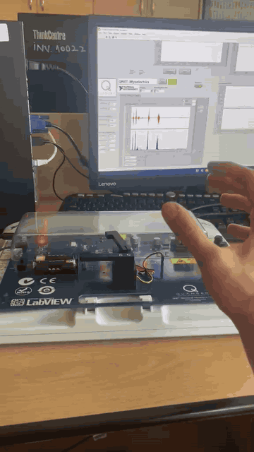
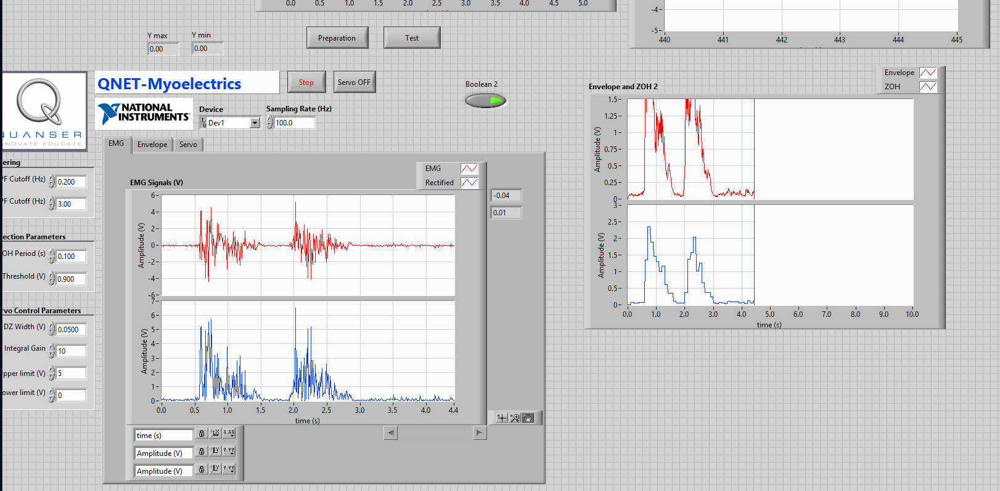
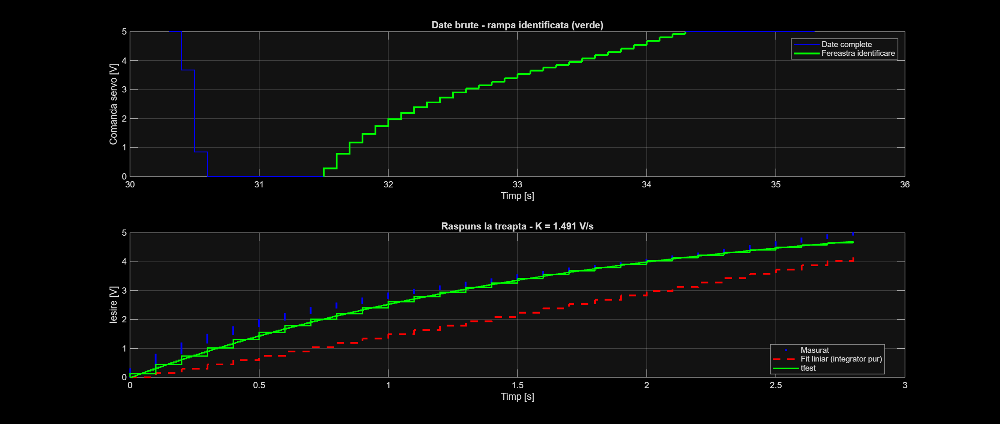
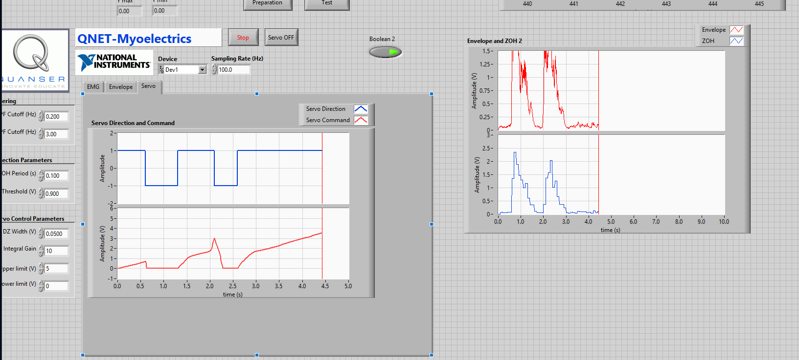

# Myoelectric Gripper Control

Proportional control of a servo-driven robotic gripper using surface EMG signals from the forearm.
Muscle contraction closes the gripper and relaxation opens it, in proportion to the effort.

University project, *Control Engineering II*, Technical University of Cluj-Napoca (2025–2026).



## Hardware

- Quanser QNET Myoelectric Trainer on NI ELVIS
- Surface EMG electrodes placed on the forearm
- Servo-driven plastic gripper, voltage-commanded: 0 V = fully open, 5 V = fully closed

**Hard constraint:** commands above 5 V overload the gripper mechanically and can damage it,
so the control output must stay within that limit at all times.

## Signal chain

```
EMG electrodes -> high-pass filter -> rectification -> low-pass filter -> envelope -> PI controller -> servo -> gripper
```

| Stage | Setting | Purpose |
|---|---|---|
| Acquisition | 100 Hz | EMG sampled through the NI DAQ |
| High-pass filter | 0.2 Hz | Removes DC offset and slow motion artifacts |
| Rectification + low-pass filter | 3 Hz | Extracts the envelope, proportional to muscle effort |
| PI controller | Kp = 1.67, Ti = 1.83 s | Turns the envelope (reference) into a smooth servo command |
| Output saturation | 0–4.8 V | Protects the gripper; anti-windup prevents integrator build-up |



## System identification

A sustained muscle contraction was used as a step input and the servo command response was recorded
in LabVIEW, exported and analysed in MATLAB. Two model structures were compared on the transient:

- **Pure integrator** (linear fit, K ≈ 1.49 V/s): misses the faster initial rise.
- **First-order model** (`tfest`): follows the measured response closely and was kept:

  **G(s) = 3.272 / (s + 0.5465)**, i.e. static gain **K = 5.99** and time constant **T = 1.83 s**.



## Controller design

- PI structure: the integral term removes the ~14 % steady-state error seen in unity feedback;
  the derivative term was left out because it would amplify the noise remaining in the EMG envelope.
- Tuned with the **modulus optimum** criterion: Ti = T = 1.83 s (the controller zero cancels the
  process pole) and Kp = 1 / (2·K·Tσ) = 1.67, with Tσ = 0.05 s for the neglected small time constants.
- Simulated closed loop on the identified model: settling time ≈ 0.72 s, no overshoot, zero
  steady-state error.
- A step reference makes the proportional term produce an initial command peak above 5 V, so the
  output was saturated at 4.8 V with anti-windup.

Implemented with the standard LabVIEW `PID.vi` (derivative disabled).

## Results



- Tested in real time with electrodes on the forearm.
- The gripper closes promptly and proportionally to the contraction and opens gradually on relaxation.
- No jitter in the relaxed state.

## Limitations

- EMG quality depends on electrode placement, skin contact and muscle fatigue, so results vary
  between sessions and users.
- The ~100 Hz acquisition rate is fixed by the platform.
- Possible improvement: setpoint weighting on the proportional term (2-DOF PI) to reduce the initial
  command peak without slowing the response.

## Repository contents

| Path | Description |
|---|---|
| `matlab/identification_and_pi_design.m` | Identification (integrator vs. first-order) and PI design |
| `data/servo_step.txt` | Recorded servo command used for identification |
| `data/emg_raw_rectified.txt` | Sample raw and rectified EMG |
| `data/envelope_zoh.txt` | Sample EMG envelope |
| `data/servo_direction_command.txt` | Sample servo direction and command |
| `media/` | Screenshots and demo |

## Tools

LabVIEW · MATLAB (System Identification Toolbox, Control System Toolbox) · Quanser QNET Myoelectric Trainer · NI ELVIS
